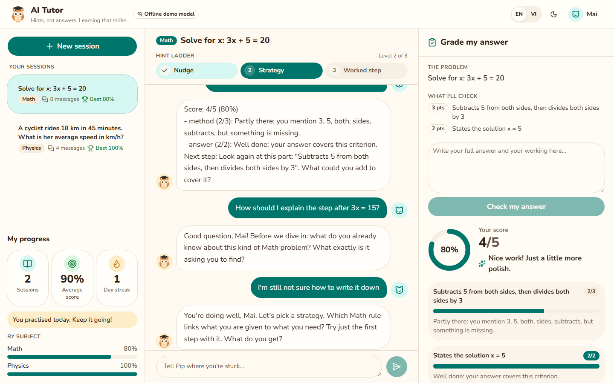
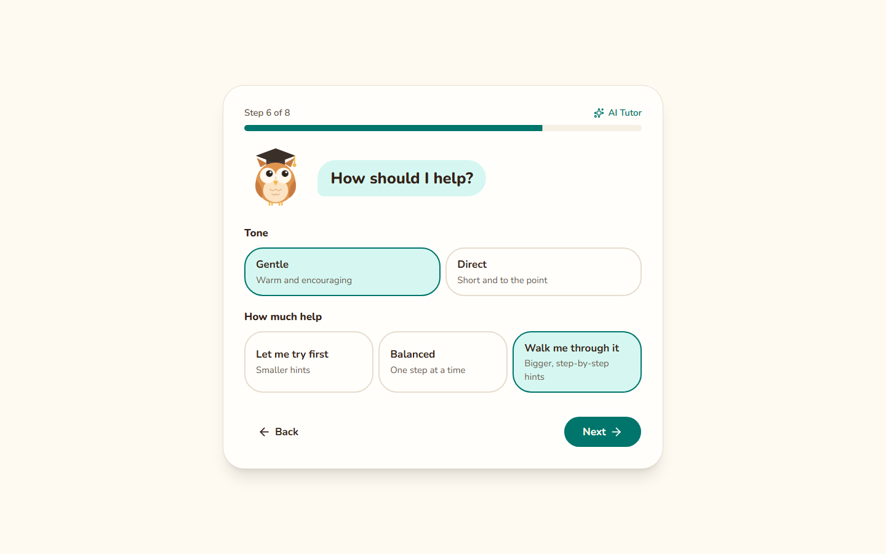
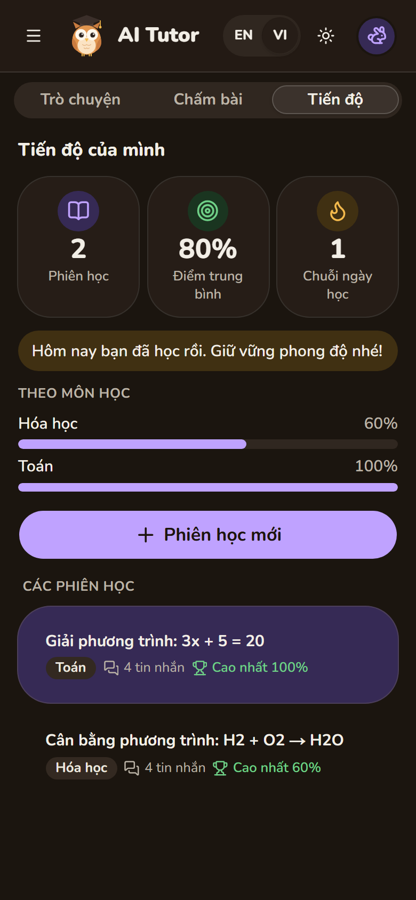
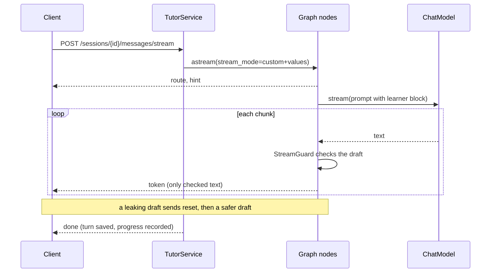

# ai-tutor-agent

[](https://github.com/vulinh1704/ai-tutor-agent/actions/workflows/ci.yml)
[](LICENSE)
[](pyproject.toml)
[](https://github.com/astral-sh/ruff)
[](https://mypy-lang.org/)
[](#mcp-server-mode)

**A production-ready starter for AI tutoring agents: FastAPI + LangGraph, with Socratic hints,
rubric-based grading, learner profiles, streaming, an MCP server and a web UI.**

<p align="center">
  
</p>

<table>
  <tr>
    <td width="62%"></td>
    <td width="38%"></td>
  </tr>
  <tr>
    <td align="center"><sub>Onboarding builds a learner profile: language, grade, subjects, goal, hint style, look</sub></td>
    <td align="center"><sub>Progress on mobile (Vietnamese, dark mode)</sub></td>
  </tr>
</table>

Most LLM tutoring demos hand students the answer. `ai-tutor-agent` does the opposite: in
homework mode it guides with Socratic hints that escalate one rung at a time, checks every
draft for answer leaks before the student sees it (even while streaming), and grades short
answers against your rubric with validated, structured output. Each learner gets a profile
(reply language, tone, how much scaffolding) that adapts every prompt, and their progress is
tracked across sessions.

It is a small, typed and tested codebase built on FastAPI and LangGraph. It runs on OpenAI or
Anthropic Claude, streams replies over server-sent events, plugs into Claude Desktop, Claude
Code and Cursor as an MCP server, and ships a Next.js web UI for secondary-school students in
English and Vietnamese. A deterministic offline model makes the tests, the demo, the web UI and
the Docker images work without an API key.

## Contents

- [Features](#features)
- [Quickstart](#quickstart)
- [Web UI](#web-ui)
- [Streaming](#streaming)
- [MCP server mode](#mcp-server-mode)
- [Learner profiles and progress](#learner-profiles-and-progress)
- [API examples](#api-examples)
- [Configuration](#configuration)
- [Architecture](#architecture)
- [Design decisions](#design-decisions)
- [Development](#development)
- [Roadmap](#roadmap)

## Features

- **Socratic tutor.** A configurable hint ladder (nudge, strategy, worked step on a similar
  example, ...) in `homework` mode; full step-by-step explanations in `explain` mode.
- **Answer-leak guard, streaming included.** Drafts that reveal the final answer (in English
  or Vietnamese) are regenerated once with a stricter instruction, then replaced by a safe
  hint. Streamed text only reaches the student after the guard has checked it. The reference
  answer is never returned by the API.
- **Rubric grading with structured output.** Per-criterion points and feedback plus a
  next-step hint, validated against the rubric. Totals are computed in code, never by the model.
- **Streaming replies.** `POST /sessions/{id}/messages/stream` sends the route decision, the
  hint level, guarded reply text, grades and a final `done` event as server-sent events.
- **MCP server mode.** `ai-tutor mcp` exposes the tutor as Model Context Protocol tools
  (`start_session`, `ask_tutor`, `submit_answer`, `grade_answer`, ...) for Claude Desktop,
  Claude Code, Cursor or any MCP host, over stdio or streamable HTTP.
- **Learner profiles and progress.** Reply language (English, Vietnamese), tone (gentle,
  direct) and scaffolding (less, standard, more) shape every prompt and the hint ladder;
  sessions, rubric scores and day streaks are tracked per learner.
- **Web UI.** A friendly Next.js app for ages 12-18: onboarding, streaming chat, a visible hint
  ladder, a "grade my answer" panel, a progress panel, light and dark themes, two languages,
  built with shadcn/ui and Animate UI.
- **Router node and session memory.** Each message goes to the tutor, the grader or a
  clarifying question, with guardrails in code; sessions are LangGraph threads in an in-memory
  or SQLite checkpointer.
- **Provider abstraction.** OpenAI (default), Anthropic Claude, or a deterministic fake model
  for tests and offline demos, selected with one environment variable.
- **Production basics.** Typed settings, fail-fast configuration errors, per-session locking,
  clean error mapping (404/422/502), non-root Docker images with health checks, and CI for four
  Python versions and the web app.

## Quickstart

Requires Python 3.11+ and [uv](https://docs.astral.sh/uv/) (or plain pip, see below). The web
UI also needs Node.js 22.12+.

```bash
git clone https://github.com/vulinh1704/ai-tutor-agent.git
cd ai-tutor-agent
uv sync --all-extras
```

### Offline demo (no API key)

```bash
uv run ai-tutor demo
```

It runs the real graph, hint policy, grader and checkpointer with the deterministic fake model,
then repeats the exercise for a learner who prefers Vietnamese, a direct tone and more
scaffolding, with each turn streamed:

```text
student > hi
tutor   [clarify, hint level 0]
          I'd love to help with this algebra problem! Which part are you stuck on, and what have you tried so far?

student > How do I even start with 3x + 5 = 20?
tutor   [tutor, hint level 1]
          Good question! Before we dive in: what do you already know about this kind of algebra problem? ...

student > Can you just tell me the answer?
tutor   [tutor, hint level 3]
          Here's one step on a simpler example: to solve 2x + 3 = 11, undo the + 3 first ... What equation do you get?

student > My answer: I subtracted 5 from both sides to get 3x = 15, then divided both sides by 3, so x = 5
tutor   [grader, hint level 0]
          Score: 5/5 (100%)
          - method (3/3): Well done: your answer covers this criterion.
          - answer (2/2): Well done: your answer covers this criterion.
          Next step: Great work! How could you check your answer in a different way?

Learner profile: Linh, language=vi, tone=direct, scaffolding=more

student > Mình nên bắt đầu bài 3x + 5 = 20 từ đâu?
tutor   [tutor, hint level 2]
          Mình cùng chọn hướng giải nhé. Quy tắc Toán nào nối những gì đề bài cho với điều cần tìm? ...
          (streamed as: route -> hint -> token x36 -> done)

student > Bài làm của mình: trừ 5 ở hai vế được 3x = 15, rồi chia hai vế cho 3 nên x = 5
tutor   [grader, hint level 0]
          Điểm: 5/5 (100%)
          ...
Progress: 1 session, 1 graded attempt, average score 100%, streak 1 day
```

### Run the API locally

```bash
cp .env.example .env          # starts in offline mode: LLM_PROVIDER=fake
uv run ai-tutor serve         # interactive docs at http://127.0.0.1:8000/docs
```

To use a real model, edit `.env`:

```bash
LLM_PROVIDER=openai           # default model: gpt-5.4-mini
OPENAI_API_KEY=your-openai-api-key

# or
LLM_PROVIDER=anthropic        # default model: claude-opus-5-5
ANTHROPIC_API_KEY=your-anthropic-api-key
```

Without uv: `python -m venv .venv && . .venv/bin/activate && pip install -e ".[sqlite,mcp]"`
(add `--group dev` with pip 25.1+ for the test tooling).

### Run the web UI

With the API running (offline mode is fine):

```bash
cd web
npm install
npm run dev                   # http://localhost:3000
```

### Docker

```bash
docker compose up --build     # API on :8000, web UI on :3000, offline by default
```

Set `LLM_PROVIDER` and the matching API key in `.env` to use a real model; Compose reads it
automatically. Sessions, learner profiles and progress are stored in SQLite on a named volume.

## Web UI

`web/` is a Next.js 16 (App Router, TypeScript) app for secondary-school students, aged 12 to
18. It is warm, encouraging and low on distractions, with Pip the owl as a study buddy.

- **Onboarding** in eight short steps builds the learner profile: name, grade, subjects, goal,
  language, hint style (tone and amount of scaffolding) and look (avatar, accent colour, text
  size). The profile is stored by the API and the learner id is cached in the browser.
- **Streaming chat** shows replies as they are written, with the route (hint, graded,
  question) on each reply and a notice when the leak guard makes Pip reword a hint.
- **Hint ladder** as a stepper (Nudge, Strategy, Worked step, ...), so learners see how much
  help they are asking for. Its length follows the learner's scaffolding preference.
- **Grade my answer** submits an attempt straight to the grader (`intent: "submit"`) and shows
  a score ring, per-criterion bars, feedback and the next step, with a small celebration for a
  perfect score.
- **My progress**: sessions practised, average rubric score, day streak and per-subject bars.
- Light and dark themes, English and Vietnamese (the browser language picks the default),
  three text sizes, keyboard-accessible controls, responsive from phones to desktops, and
  animations that respect the system "reduce motion" setting.
- Built-in practice problems (math, physics, chemistry, English, biology) with rubrics in both
  languages, or bring your own question.

Components come from [shadcn/ui](https://ui.shadcn.com), animated with
[Animate UI](https://animate-ui.com) (Motion) through its npm package; see
[web/README.md](web/README.md) and [THIRD_PARTY_NOTICES.md](THIRD_PARTY_NOTICES.md).

## Streaming

`POST /sessions/{id}/messages/stream` takes the same body as `POST /sessions/{id}/messages`
and answers with server-sent events:

| Event | Data |
| --- | --- |
| `route` | `{route, reason, new_problem}`: the router's decision |
| `hint` | `{hint_level, max_hint_level}`: the ladder rung used for this reply (0 outside it) |
| `token` | `{text}`: reply text that has passed the answer-leak guard |
| `reset` | `{reason: "answer_leak"}`: discard the text so far, a safer draft follows |
| `grade` | `{grade}`: per-criterion scores, when an answer was graded |
| `done` | the saved turn, same shape as the non-streaming response |
| `error` | `{status, detail}`: the turn failed after the stream started |

```bash
curl -N -X POST localhost:8000/sessions/$SID/messages/stream \
  -H 'Content-Type: application/json' -d '{"content": "How do I start with 3x + 5 = 20?"}'
```

```text
event: route
data: {"type":"route","route":"tutor","reason":"The student is asking for help.","new_problem":false}

event: hint
data: {"type":"hint","hint_level":1,"max_hint_level":3}

event: token
data: {"type":"token","text":"Good "}

event: token
data: {"type":"token","text":"question! "}
...
event: done
data: {"type":"done","session_id":"...","route":"tutor","reply":"Good question! ...","hint_level":1,"grade":null}
```

An unknown session (`404`) or an invalid body (`422`) is reported before the stream starts.
Streamed turns run in their own task, so a dropped connection never leaves a half-saved turn.
`EventSource` only supports GET, so browsers read the stream with `fetch`; see
[`web/src/lib/sse.ts`](web/src/lib/sse.ts) for a small, tested parser.

## MCP server mode

`ai-tutor mcp` runs the tutor as a [Model Context Protocol](https://modelcontextprotocol.io)
server, built with the official MCP Python SDK (v2). It needs the `mcp` extra
(`uv sync --all-extras` installs it).

| Tool | What it does |
| --- | --- |
| `create_learner` | Create a learner profile (language, tone, scaffolding, goal) |
| `start_session` | Start a session, optionally about a question with a rubric and hidden reference answer |
| `ask_tutor` | Send the student's message; returns a hint at the next ladder level |
| `submit_answer` | Grade an attempt against the session rubric |
| `grade_answer` | Stateless grading of an answer against a rubric |
| `get_progress` | Sessions practised, average score and streaks for a learner |

The resource `tutor://sessions/{session_id}/transcript` returns a session as Markdown. The
server's instructions ask the host model to relay the tutor's hints rather than solve the
problem itself.

**Claude Desktop**: add to `claude_desktop_config.json` (`%APPDATA%\Claude\` on Windows,
`~/Library/Application Support/Claude/` on macOS), then fully quit and reopen Claude Desktop:

```json
{
  "mcpServers": {
    "ai-tutor": {
      "command": "uv",
      "args": ["run", "--directory", "/absolute/path/to/ai-tutor-agent", "--extra", "mcp", "ai-tutor", "mcp"],
      "env": { "LLM_PROVIDER": "fake" }
    }
  }
}
```

**Claude Code**:

```bash
claude mcp add ai-tutor -e LLM_PROVIDER=fake -- \
  uv run --directory /absolute/path/to/ai-tutor-agent --extra mcp ai-tutor mcp
```

**Cursor**: the same `mcpServers` entry as Claude Desktop, in `.cursor/mcp.json` in your
project (or `~/.cursor/mcp.json` for every project).

Swap `LLM_PROVIDER=fake` for `openai` or `anthropic` plus the matching API key in `env` (or in
the project's `.env`) to tutor with a real model. If the host can't find `uv`, use its absolute
path (`which uv`). Over HTTP instead of stdio:

```bash
uv run ai-tutor mcp --transport streamable-http --port 8001   # http://127.0.0.1:8001/mcp
claude mcp add --transport http ai-tutor http://127.0.0.1:8001/mcp
```

The Docker image includes the extra too:
`docker run -i --rm -e LLM_PROVIDER=fake ai-tutor-agent:local ai-tutor mcp`.

## Learner profiles and progress

A learner profile outlives sessions. Create one with `POST /learners`, then pass its
`learner_id` when creating sessions:

```bash
LID=$(curl -s -X POST localhost:8000/learners -H 'Content-Type: application/json' -d '{
  "display_name": "Linh", "level": "grade 8", "subjects": ["math"],
  "goal": "Feel confident with equations", "timezone": "Asia/Ho_Chi_Minh",
  "preferences": {"language": "vi", "tone": "gentle", "scaffolding": "more"}
}' | jq -r .learner_id)
```

| Preference | Effect |
| --- | --- |
| `language`: `en`, `vi` | Reply language of the tutor and grader, and of canned replies |
| `tone`: `gentle`, `direct` | Warm and encouraging, or brief and to the point (never condescending) |
| `scaffolding`: `less`, `standard`, `more` | `more` starts the hint ladder one rung higher; `less` stops it one rung lower |

The service reads the latest profile on every turn, so a change applies from the next message.
Name and goal go into a `<learner>` block of the prompt and are treated as data, never as
instructions. `GET /learners/{id}/progress` returns sessions practised, graded attempts, the
average rubric score, current and best day streaks (in the learner's time zone) and
per-subject averages; `GET /learners/{id}/sessions` lists the learner's sessions.

Every graded attempt is stored with its per-criterion scores, the session's subject and the
assignment's optional `skills` tags: the raw material for the skill-mastery and
spaced-repetition features on the [roadmap](#roadmap).

## API examples

| Method | Path | Purpose |
| --- | --- | --- |
| `GET` | `/health` | Liveness, version, active provider and model |
| `POST` | `/sessions` | Create a tutoring session (subject, level, mode, optional assignment and `learner_id`) |
| `GET` | `/sessions/{id}` | Session profile, message history, hint level and latest grade |
| `POST` | `/sessions/{id}/messages` | Send a student message; returns route, reply, hint level, grade |
| `POST` | `/sessions/{id}/messages/stream` | The same, streamed as server-sent events |
| `POST` | `/grade` | Stateless grading of a short answer against a rubric |
| `POST` | `/learners` | Create a learner profile |
| `GET`, `PUT` | `/learners/{id}` | Read or replace a learner profile |
| `GET` | `/learners/{id}/sessions` | The learner's sessions, most recent first |
| `GET` | `/learners/{id}/progress` | Sessions, average score, streaks, per-subject averages |

```bash
# Create a homework session with an assignment, a rubric and a hidden reference answer
SID=$(curl -s -X POST localhost:8000/sessions -H 'Content-Type: application/json' \
  -d @examples/create-session.json | jq -r .session_id)

# Ask for help: the tutor answers with a hint, not the solution
curl -s -X POST localhost:8000/sessions/$SID/messages -H 'Content-Type: application/json' \
  -d '{"content": "How do I start with 3x + 5 = 20?"}'
```

```json
{
  "session_id": "fe10c7393e824617a3719a06256cd4ff",
  "route": "tutor",
  "reply": "Good question! Before we dive in: what do you already know about this kind of algebra problem? What exactly is it asking you to find?",
  "hint_level": 1,
  "grade": null
}
```

Submitting an attempt in the chat routes it to the grader, which scores it against the session
rubric; `"intent": "submit"` skips the router and grades the message directly. Standalone
grading works the same way:

```bash
curl -s -X POST localhost:8000/grade -H 'Content-Type: application/json' \
  -d @examples/grade-request.json
```

```json
{
  "score": 7,
  "max_score": 10,
  "percentage": 70.0,
  "criteria": [
    {"criterion_id": "products", "points": 3, "max_points": 3, "feedback": "Well done: your answer covers this criterion."},
    {"criterion_id": "energy", "points": 4, "max_points": 4, "feedback": "Well done: your answer covers this criterion."},
    {"criterion_id": "chlorophyll", "points": 0, "max_points": 3, "feedback": "This part is missing from your answer."}
  ],
  "next_step_hint": "Look again at this part: \"Mentions chlorophyll capturing sunlight\". What could you add to cover it?"
}
```

(Responses above come from the offline fake model; real models write richer feedback in the
same shape.)

Errors use FastAPI's `{"detail": ...}` shape: `404` for an unknown session or learner, `422`
for invalid input or when the model declines a request, and `502` when the provider fails or
keeps returning an invalid grading.

## Configuration

All settings are environment variables (or a `.env` file). See [`.env.example`](.env.example).

| Variable | Default | Description |
| --- | --- | --- |
| `LLM_PROVIDER` | `openai` | `openai`, `anthropic` or `fake` (offline, deterministic) |
| `LLM_MODEL` | per provider | Overrides `gpt-5.4-mini` / `claude-opus-5-5` |
| `OPENAI_API_KEY` | | Required when `LLM_PROVIDER=openai` |
| `OPENAI_BASE_URL` | | Azure OpenAI or any OpenAI-compatible gateway |
| `OPENAI_REASONING_EFFORT` | model default | `none` ... `xhigh` |
| `ANTHROPIC_API_KEY` | | Required when `LLM_PROVIDER=anthropic` |
| `ANTHROPIC_EFFORT` | `medium` | Claude effort: `low` ... `max` |
| `ANTHROPIC_SERVER_FALLBACK` | `true` | Re-run declined requests on Anthropic's fallback model |
| `LLM_TEMPERATURE` | unset | OpenAI only, for models that accept it |
| `LLM_MAX_TOKENS` / `LLM_TIMEOUT_SECONDS` / `LLM_MAX_RETRIES` | `16000` / `60` / `2` | Request limits |
| `MAX_HINT_LEVEL` | `3` | Highest rung of the hint ladder (1-5) |
| `HISTORY_WINDOW` | `20` | Messages sent to the model per turn |
| `CHECKPOINTER` | `memory` | `memory` or `sqlite` (needs the `sqlite` extra); also stores learners |
| `SQLITE_PATH` | `data/checkpoints.sqlite` | SQLite database file |
| `CORS_ORIGINS` | `http://localhost:3000,http://127.0.0.1:3000` | Browser origins allowed to call the API |
| `FAKE_STREAM_DELAY_MS` | `25` | Pause between streamed words of the offline model (`0` for instant) |
| `NEXT_PUBLIC_API_URL` (web) | `http://localhost:8000` | Where the web UI reaches the API; set at build time |

## Architecture

The agent is a small LangGraph `StateGraph`. Every chat turn enters at the router, runs exactly
one handler node and ends:


How a request flows through the layers:

```mermaid
flowchart LR
    web["Web UI<br/>Next.js"] -->|"REST + SSE"| api[FastAPI routes]
    client[HTTP clients] -->|REST| api
    host["MCP hosts<br/>Claude, Cursor"] -->|"stdio / HTTP"| mcp[MCP server]
    api --> service[TutorService]
    mcp --> service
    service -->|"thread_id = session_id"| graph[LangGraph graph]
    service --> learners["LearnerStore<br/>profiles, attempts, streaks"]
    graph <--> checkpointer[("Checkpointer<br/>memory / SQLite")]
    learners <--> store[("LangGraph store<br/>memory / SQLite")]
    graph --> port["ChatModel protocol<br/>complete / stream / structured"]
    port --> openai[OpenAI]
    port --> claude[Anthropic Claude]
    port --> fake[Fake model]
```

A streamed turn: nodes report progress through LangGraph's custom stream writer, and the
service forwards it as typed events.



`ai-tutor graph` prints the diagram generated by LangGraph itself.

```text
src/ai_tutor_agent/
├── api/              FastAPI app factory, routes (REST + SSE), request/response models, errors
├── agent/
│   ├── graph.py          StateGraph wiring
│   ├── nodes.py          router, tutor, grader, clarify (they emit stream events)
│   ├── events.py         typed stream events (route, hint, token, reset, grade, done, error)
│   ├── hint_policy.py    hint ladder (with scaffolding) + answer-leak guard
│   ├── stream_guard.py   the leak guard applied to streamed text
│   ├── grading.py        rubric validation and scoring
│   ├── learners.py       learner profiles, attempts, progress and streaks (LangGraph store)
│   ├── service.py        sessions and chat turns (whole or streamed) on top of the graph
│   └── checkpointer.py   memory / SQLite checkpointer and store
├── llm/              ChatModel protocol, LangChain adapter, provider factory, fake model
├── mcp_server.py     MCP tools and resources (ai-tutor mcp)
├── prompts.py        prompt builders (XML-tagged inputs, learner block)
├── i18n.py           canned replies in English and Vietnamese
├── schemas.py        domain models and LLM output schemas
├── config.py         pydantic-settings configuration
└── cli.py            ai-tutor serve | mcp | demo | graph
web/                  Next.js web UI (see web/README.md)
```

## Design decisions

### Why LangGraph

A tutoring turn has a known shape (route, then tutor, grade or clarify), so this is a
**workflow, not an open-ended agent loop**. LangGraph models it explicitly: routing is an edge
in a graph rather than an instruction buried in a prompt, so it is cheap, predictable and easy
to test. Its checkpointers give per-session memory for free: a session is a thread, its
profile and history are graph state, and moving from memory to SQLite (or Postgres) is a
configuration change. Its store keeps what outlives a session (learner profiles and
progress) behind the same switch. Nodes are plain async methods, so each one is
unit-testable, and the compiled graph renders its own diagram.

### Why structured output

The router and the grader return Pydantic models through each provider's native JSON-schema
structured output (OpenAI strict `json_schema`, Claude `output_config.format`). The LLM-facing
schemas are deliberately simple (every field required, no numeric constraints) so the same
schema works on both providers. Semantic checks live in code: every rubric criterion must be
assessed exactly once, with points in range. The model judges each criterion, code does the
arithmetic, and invalid output gets one corrective retry before the API returns `502`. A
missing or wrong grade is better than a silently wrong one.

### How the hint policy works

In homework mode the tutor climbs a ladder, one rung per consecutive tutoring turn on the same
problem:

| Level | Style |
| --- | --- |
| 1 | **Nudge**: one guiding question, no method, no steps |
| 2 | **Strategy**: name the concept or method, ask the student to try the first step |
| 3 | **Worked step**: show one step on a different, simpler example |
| 4 | **Scaffold**: the remaining steps as a checklist with blanks |
| 5 | **Near-solution**: every step except the last |

The ladder is capped by `MAX_HINT_LEVEL` (default 3). A learner who wants more support starts
one rung higher; one who wants less stops one rung lower. The ladder restarts when the router
detects a new problem and after a graded attempt. Before any reply is sent, a **leak guard**
checks it for giveaway phrasing ("the answer is ...", "final answer: ...", "đáp án là ...")
and for the session's hidden reference answer: equations such as `x = 5` match anywhere, short
answers only when stated as a result ("is 5", "= 5", "là 5"), and longer phrases by
containment. A leaking draft is regenerated once with a stricter instruction; if it leaks
again, a canned Socratic hint is sent instead. The grader's next-step hint goes through the
same check. The guard is a fast heuristic by design; an LLM-judge check is on the roadmap.

### Streaming without weakening the guard

Streaming and a leak guard pull in opposite directions: the student should see text as soon
as possible, but the guard has to see it first. `StreamGuard` resolves it. Each chunk is added
to the draft, the draft is checked up to its last whitespace (a half-written number such as
"5" in "50" must not raise a false alarm), and released text stays a hold-back window behind
the checked text, so even the opening words of a leaking phrase never reach the screen. If the
draft leaks, generation stops, the client gets a `reset` event and the regenerated draft (or
the safe fallback) streams instead. Explain mode, which has no guard, streams tokens as they
arrive. The text a student finally sees is exactly what the non-streaming path sends, and a
property test checks that for random chunkings of leaking and clean drafts.

### Personalisation without prompt injection

Learner preferences become a `<learner>` block plus fixed rules chosen in code (language,
tone, scaffolding). The free-text parts (name, goal) stay inside the tag and the prompt says
they are data, the same treatment as questions, rubrics and student answers. The hint ladder
adapts in code, not by asking the model to be "more helpful".

### One interface, three providers

The graph depends only on a small `ChatModel` protocol: `complete()` and `stream()` for text and
`structured()` for validated Pydantic output. OpenAI and Claude go through one LangChain
adapter that also maps refusals to a dedicated error (`422`), for whole and streamed replies.
Provider-specific choices:

- **Claude** uses native structured outputs rather than a forced tool call (current Claude
  models reject forced `tool_choice`), never sends `temperature` (rejected by Claude's current
  API), sets effort through `output_config.effort`, and opts into server-side fallback so a
  declined request can be retried on Anthropic's recommended fallback model.
- **OpenAI** uses strict JSON-schema output and an optional reasoning effort.
- **Fake** is deterministic and offline. It reads the same XML-tagged prompts a real model
  sees (including the learner's language, tone and scaffolding), so the tests, the demo and
  the web UI exercise the real graph, prompts and validation.

## Development

```bash
make install     # uv sync --all-extras + pre-commit hooks
make check       # ruff + mypy (strict) + pytest with coverage
make demo        # offline scripted session
make mcp         # MCP server over stdio
make web-install # npm ci in web/
make web-check   # web lint + typecheck + tests + production build
```

The Python test-suite (255 tests, ~99% coverage) never touches the network: graph, API, MCP,
streaming and grading tests use the fake model, and the provider tests build real OpenAI and
Claude clients with sockets disabled and inspect the request they would send. The web app has
Vitest + React Testing Library tests for the SSE parser, i18n, onboarding, the hint ladder,
grading and progress. See [CONTRIBUTING.md](CONTRIBUTING.md) for the workflow.

## Roadmap

- [ ] Knowledge map and skill mastery from graded attempts and skill tags
- [ ] Spaced-repetition review of weak skills
- [ ] Upload course materials (RAG) for grounded hints
- [ ] Teacher and parent mode
- [ ] LLM-judge leak check and an evaluation set of golden conversations
- [ ] Postgres checkpointer and store
- [ ] Authentication, per-tenant rate limits and usage metrics
- [ ] Tracing (OpenTelemetry / LangSmith) with token and cost reporting
- [ ] More reply and UI languages

## License

[MIT](LICENSE) © Vu Linh Truong. Third-party components (including Animate UI, used under
MIT + Commons Clause as an npm dependency) are listed in
[THIRD_PARTY_NOTICES.md](THIRD_PARTY_NOTICES.md).

---

Built by **Vu Linh Truong**:
[GitHub](https://github.com/vulinh1704) ·
[LinkedIn](https://linkedin.com/in/vu-linh-truong-4330b4317)
