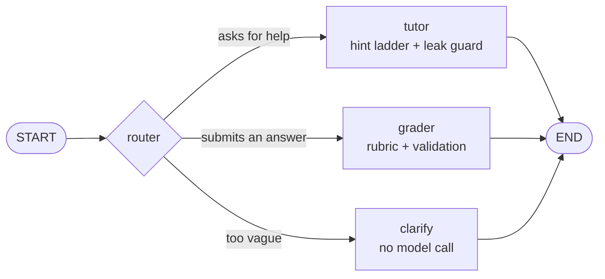

# ai-tutor-agent

[](https://github.com/vulinh1704/ai-tutor-agent/actions/workflows/ci.yml)
[](LICENSE)
[](pyproject.toml)
[](https://github.com/astral-sh/ruff)
[](https://mypy-lang.org/)

**A production-ready starter for AI tutoring agents: FastAPI + LangGraph, with Socratic hints,
rubric-based grading and session memory.**

Most LLM tutoring demos hand students the answer. `ai-tutor-agent` does the opposite: in
homework mode it guides with Socratic hints that escalate one rung at a time, checks every
draft for answer leaks before it is sent, and grades short answers against your rubric with
validated, structured output. It is a small, typed and tested codebase built on FastAPI and
LangGraph. It runs on OpenAI or Anthropic Claude, keeps per-session memory in a pluggable
checkpointer, and ships with a deterministic offline model, so the tests, the demo and the
Docker image all work without an API key.

## Contents

- [Features](#features)
- [Quickstart](#quickstart)
- [API examples](#api-examples)
- [Configuration](#configuration)
- [Architecture](#architecture)
- [Design decisions](#design-decisions)
- [Development](#development)
- [Roadmap](#roadmap)

## Features

- **Socratic tutor.** A configurable hint ladder (nudge, strategy, worked step on a similar
  example, ...) in `homework` mode; full step-by-step explanations in `explain` mode.
- **Answer-leak guard.** Drafts that reveal the final answer are regenerated once with a
  stricter instruction, then replaced by a safe hint. The reference answer is never returned
  by the API.
- **Rubric grading with structured output.** Per-criterion points and feedback plus a
  next-step hint, validated against the rubric. Totals are computed in code, never by the model.
- **Router node.** Each message goes to the tutor, the grader or a clarifying question, with
  guardrails applied in code (for example, no grading without a rubric).
- **Session memory.** A session is a LangGraph thread. State lives in an in-memory or SQLite
  checkpointer and survives restarts with SQLite.
- **Provider abstraction.** OpenAI (default), Anthropic Claude, or a deterministic fake model
  for tests and offline demos, selected with one environment variable.
- **Production basics.** Typed settings, fail-fast configuration errors, per-session locking,
  clean error mapping (404/422/502), a non-root Docker image with a health check, and CI on four
  Python versions.

## Quickstart

Requires Python 3.11+ and [uv](https://docs.astral.sh/uv/) (or plain pip, see below).

```bash
git clone https://github.com/vulinh1704/ai-tutor-agent.git
cd ai-tutor-agent
uv sync --all-extras
```

### Offline demo (no API key)

```bash
uv run ai-tutor demo
```

It runs the real graph, hint policy, grader and checkpointer with the deterministic fake model:

```text
student > hi
tutor   [clarify, hint level 0]
          I'd love to help with this algebra problem! Which part are you stuck on, and what have you tried so far?

student > How do I even start with 3x + 5 = 20?
tutor   [tutor, hint level 1]
          Good question! Before we dive in: what do you already know about this kind of algebra problem? ...

student > Can you just tell me the answer?
tutor   [tutor, hint level 3]
          Here's one step on a simpler example: to solve 2x + 3 = 11, undo the + 3 first ... What equation do you get?

student > My answer: I subtracted 5 from both sides to get 3x = 15, then divided both sides by 3, so x = 5
tutor   [grader, hint level 0]
          Score: 5/5 (100%)
          - method (3/3): Well done: your answer covers this criterion.
          - answer (2/2): Well done: your answer covers this criterion.
          Next step: Great work! How could you check your answer in a different way?
```

### Run the API locally

```bash
cp .env.example .env          # starts in offline mode: LLM_PROVIDER=fake
uv run ai-tutor serve         # interactive docs at http://127.0.0.1:8000/docs
```

To use a real model, edit `.env`:

```bash
LLM_PROVIDER=openai           # default model: gpt-5.4-mini
OPENAI_API_KEY=your-openai-api-key

# or
LLM_PROVIDER=anthropic        # default model: claude-opus-5-5
ANTHROPIC_API_KEY=your-anthropic-api-key
```

Without uv: `python -m venv .venv && . .venv/bin/activate && pip install -e ".[sqlite]"`
(add `--group dev` with pip 25.1+ for the test tooling).

### Docker

```bash
docker compose up --build     # offline mode by default, SQLite on a named volume
```

Set `LLM_PROVIDER` and the matching API key in `.env` to use a real model; Compose reads it
automatically.

## API examples

| Method | Path | Purpose |
| --- | --- | --- |
| `GET` | `/health` | Liveness, version, active provider and model |
| `POST` | `/sessions` | Create a tutoring session (subject, level, mode, optional assignment) |
| `GET` | `/sessions/{id}` | Session profile and message history |
| `POST` | `/sessions/{id}/messages` | Send a student message; returns route, reply, hint level, grade |
| `POST` | `/grade` | Stateless grading of a short answer against a rubric |

```bash
# Create a homework session with an assignment, a rubric and a hidden reference answer
SID=$(curl -s -X POST localhost:8000/sessions -H 'Content-Type: application/json' \
  -d @examples/create-session.json | jq -r .session_id)

# Ask for help: the tutor answers with a hint, not the solution
curl -s -X POST localhost:8000/sessions/$SID/messages -H 'Content-Type: application/json' \
  -d '{"content": "How do I start with 3x + 5 = 20?"}'
```

```json
{
  "session_id": "fe10c7393e824617a3719a06256cd4ff",
  "route": "tutor",
  "reply": "Good question! Before we dive in: what do you already know about this kind of algebra problem? What exactly is it asking you to find?",
  "hint_level": 1,
  "grade": null
}
```

Submitting an attempt in the chat routes it to the grader, which scores it against the session
rubric. Standalone grading works the same way:

```bash
curl -s -X POST localhost:8000/grade -H 'Content-Type: application/json' \
  -d @examples/grade-request.json
```

```json
{
  "score": 7,
  "max_score": 10,
  "percentage": 70.0,
  "criteria": [
    {"criterion_id": "products", "points": 3, "max_points": 3, "feedback": "Well done: your answer covers this criterion."},
    {"criterion_id": "energy", "points": 4, "max_points": 4, "feedback": "Well done: your answer covers this criterion."},
    {"criterion_id": "chlorophyll", "points": 0, "max_points": 3, "feedback": "This part is missing from your answer."}
  ],
  "next_step_hint": "Look again at this part: \"Mentions chlorophyll capturing sunlight\". What could you add to cover it?"
}
```

(Responses above come from the offline fake model; real models write richer feedback in the
same shape.)

Errors use FastAPI's `{"detail": ...}` shape: `404` for an unknown session, `422` for invalid
input or when the model declines a request, and `502` when the provider fails or keeps
returning an invalid grading.

## Configuration

All settings are environment variables (or a `.env` file). See [`.env.example`](.env.example).

| Variable | Default | Description |
| --- | --- | --- |
| `LLM_PROVIDER` | `openai` | `openai`, `anthropic` or `fake` (offline, deterministic) |
| `LLM_MODEL` | per provider | Overrides `gpt-5.4-mini` / `claude-opus-5-5` |
| `OPENAI_API_KEY` | | Required when `LLM_PROVIDER=openai` |
| `OPENAI_BASE_URL` | | Azure OpenAI or any OpenAI-compatible gateway |
| `OPENAI_REASONING_EFFORT` | model default | `none` ... `xhigh` |
| `ANTHROPIC_API_KEY` | | Required when `LLM_PROVIDER=anthropic` |
| `ANTHROPIC_EFFORT` | `medium` | Claude effort: `low` ... `max` |
| `ANTHROPIC_SERVER_FALLBACK` | `true` | Re-run declined requests on Anthropic's fallback model |
| `LLM_TEMPERATURE` | unset | OpenAI only, for models that accept it |
| `LLM_MAX_TOKENS` / `LLM_TIMEOUT_SECONDS` / `LLM_MAX_RETRIES` | `16000` / `60` / `2` | Request limits |
| `MAX_HINT_LEVEL` | `3` | Highest rung of the hint ladder (1-5) |
| `HISTORY_WINDOW` | `20` | Messages sent to the model per turn |
| `CHECKPOINTER` | `memory` | `memory` or `sqlite` (needs the `sqlite` extra) |
| `SQLITE_PATH` | `data/checkpoints.sqlite` | SQLite database file |

## Architecture

The agent is a small LangGraph `StateGraph`. Every chat turn enters at the router, runs exactly
one handler node and ends:



How a request flows through the layers:

```mermaid
flowchart LR
    client[Client] -->|HTTP| api[FastAPI routes]
    api --> service[TutorService]
    service -->|"thread_id = session_id"| graph[LangGraph graph]
    graph <--> checkpointer[("Checkpointer<br/>memory / SQLite")]
    graph --> port[ChatModel protocol]
    port --> openai[OpenAI]
    port --> claude[Anthropic Claude]
    port --> fake[Fake model]
```

`ai-tutor graph` prints the diagram generated by LangGraph itself.

```text
src/ai_tutor_agent/
├── api/            FastAPI app factory, routes, request/response models, error mapping
├── agent/
│   ├── graph.py        StateGraph wiring
│   ├── nodes.py        router, tutor, grader, clarify
│   ├── hint_policy.py  hint ladder + answer-leak guard
│   ├── grading.py      rubric validation and scoring
│   ├── service.py      sessions and chat turns on top of the graph
│   └── checkpointer.py memory / SQLite
├── llm/            ChatModel protocol, LangChain adapter, provider factory, fake model
├── prompts.py      prompt builders (XML-tagged inputs)
├── schemas.py      domain models and LLM output schemas
├── config.py       pydantic-settings configuration
└── cli.py          ai-tutor serve | demo | graph
```

## Design decisions

### Why LangGraph

A tutoring turn has a known shape (route, then tutor, grade or clarify), so this is a
**workflow, not an open-ended agent loop**. LangGraph models it explicitly: routing is an edge
in a graph rather than an instruction buried in a prompt, so it is cheap, predictable and easy
to test. Its checkpointers give per-session memory for free: a session is a thread, its
profile and history are graph state, and moving from memory to SQLite (or Postgres) is a
configuration change. Nodes are plain async methods, so each one is unit-testable, and the
compiled graph renders its own diagram.

### Why structured output

The router and the grader return Pydantic models through each provider's native JSON-schema
structured output (OpenAI strict `json_schema`, Claude `output_config.format`). The LLM-facing
schemas are deliberately simple (every field required, no numeric constraints) so the same
schema works on both providers. Semantic checks live in code: every rubric criterion must be
assessed exactly once, with points in range. The model judges each criterion, code does the
arithmetic, and invalid output gets one corrective retry before the API returns `502`. A
missing or wrong grade is better than a silently wrong one.

### How the hint policy works

In homework mode the tutor climbs a ladder, one rung per consecutive tutoring turn on the same
problem:

| Level | Style |
| --- | --- |
| 1 | **Nudge**: one guiding question, no method, no steps |
| 2 | **Strategy**: name the concept or method, ask the student to try the first step |
| 3 | **Worked step**: show one step on a different, simpler example |
| 4 | **Scaffold**: the remaining steps as a checklist with blanks |
| 5 | **Near-solution**: every step except the last |

The ladder is capped by `MAX_HINT_LEVEL` (default 3). It restarts when the router detects a new
problem and after a graded attempt. Before any reply is sent, a **leak guard** checks it for
giveaway phrasing ("the answer is ...", "final answer: ...") and for the session's hidden
reference answer: equations such as `x = 5` match anywhere, short answers only when stated as
a result ("is 5", "= 5"), and longer phrases by containment. A leaking draft is regenerated
once with a stricter instruction; if it leaks again, a canned Socratic hint is sent instead.
The grader's next-step hint goes through the same check. The guard is a fast heuristic by
design; an LLM-judge check is on the roadmap.

### One interface, three providers

The graph depends only on a two-method `ChatModel` protocol: `complete()` for text and
`structured()` for validated Pydantic output. OpenAI and Claude go through one LangChain
adapter that also maps refusals to a dedicated error (`422`). Provider-specific choices:

- **Claude** uses native structured outputs rather than a forced tool call (current Claude
  models reject forced `tool_choice`), never sends `temperature` (rejected by Claude's current
  API), sets effort through `output_config.effort`, and opts into server-side fallback so a
  declined request can be retried on Anthropic's recommended fallback model.
- **OpenAI** uses strict JSON-schema output and an optional reasoning effort.
- **Fake** is deterministic and offline. It reads the same XML-tagged prompts a real model
  sees, so the tests and the demo exercise the real graph, prompts and validation.

## Development

```bash
make install     # uv sync --all-extras + pre-commit hooks
make check       # ruff + mypy (strict) + pytest with coverage
make demo        # offline scripted session
```

The test-suite (130+ tests, ~99% coverage) never touches the network: graph, API and grading
tests use the fake model, and the provider tests build real OpenAI and Claude clients with
sockets disabled and inspect the request they would send. See
[CONTRIBUTING.md](CONTRIBUTING.md) for the workflow.

## Roadmap

- [ ] Streaming tutor replies (server-sent events)
- [ ] LLM-judge leak check and an evaluation set of golden conversations
- [ ] Postgres checkpointer and a long-term learner profile store
- [ ] Retrieval over course material for grounded hints
- [ ] Authentication, per-tenant rate limits and usage metrics
- [ ] Tracing (OpenTelemetry / LangSmith) with token and cost reporting
- [ ] Multilingual tutoring

## License

[MIT](LICENSE) © Vu Linh Truong

---

Built by **Vu Linh Truong**:
[GitHub](https://github.com/vulinh1704) ·
[LinkedIn](https://linkedin.com/in/vu-linh-truong-4330b4317)
